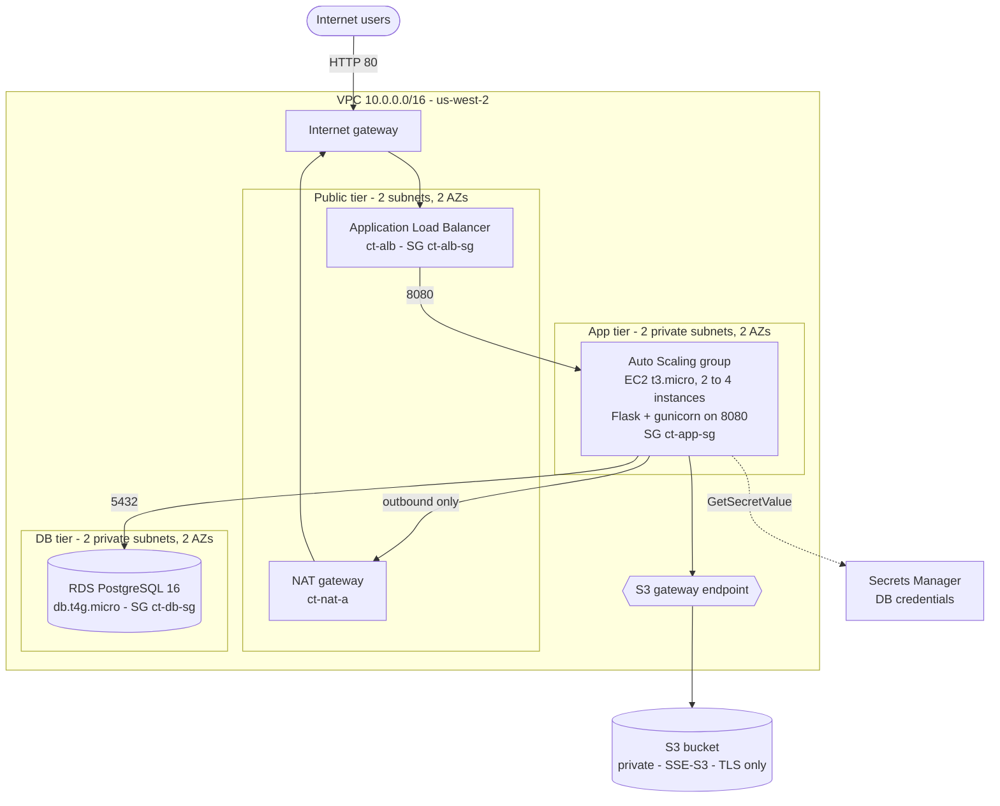
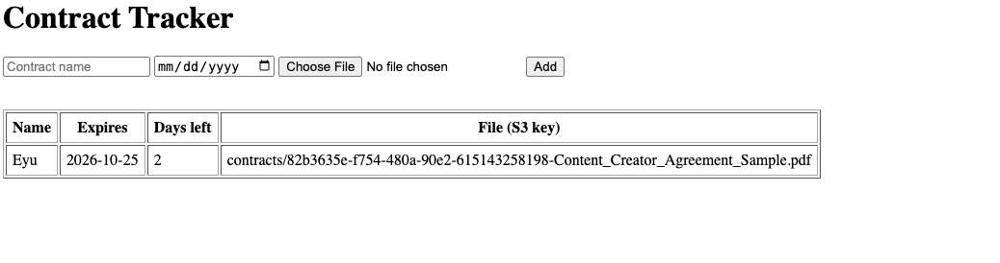
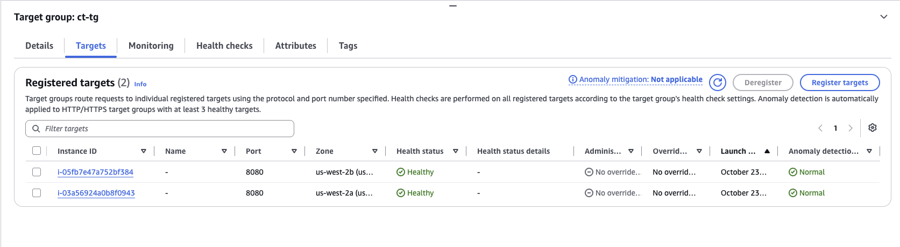
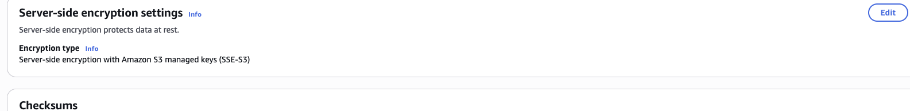
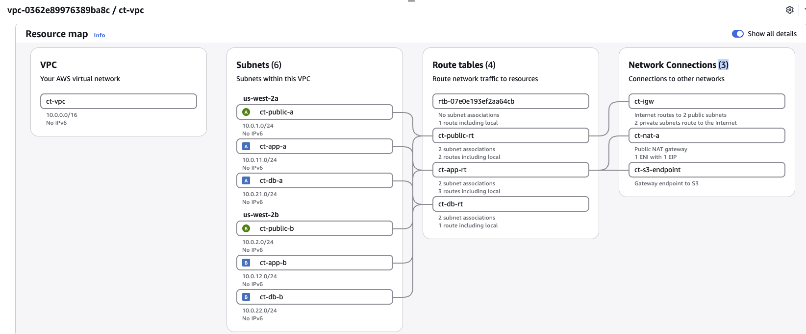

# Contract Tracker on AWS

A contract expiration tracker built as a three-tier application on AWS. Users add a contract (name, expiration date, PDF) and see how many days are left. It is deliberately built to be secure, highly available, and cheap to run in a learning budget.

> **Status:** console build complete and tested (Phases 0–6). The whole stack is now rebuilt in Terraform with remote state in S3, and a GitHub Actions pipeline (OIDC, plan-only) checks every pull request. Next: security scans, a demo video, containers and monitoring.

## Architecture



**Request flow:** browser -> internet gateway -> ALB (public subnets) -> app servers (private subnets, port 8080) -> PostgreSQL (private subnets, port 5432). PDFs go to S3 through a gateway endpoint; DB credentials come from Secrets Manager at runtime.

## Design decisions

| Area | Decision | Why |
|---|---|---|
| Network | /16 VPC, six /24 subnets (public, app, DB x 2 AZs), one route table per tier | Clear separation; a subnet is "public" only because its route table points at the internet gateway |
| Security groups | Chained by reference: internet -> `ct-alb-sg` (80) -> `ct-app-sg` (8080) -> `ct-db-sg` (5432) | Each tier accepts traffic only from the tier in front of it; no IP ranges to maintain |
| Credentials | EC2 instance role (temporary credentials), least-privilege inline policy, DB password in Secrets Manager | No access keys on servers or in code |
| Access to servers | Session Manager, no SSH, no key pairs, no open port 22 | Smaller attack surface, audited access |
| Storage | S3 with block public access, versioning, SSE-S3, and a TLS-only bucket policy | Contracts are sensitive documents |
| Database | RDS PostgreSQL in private subnets, public access off | Only the app tier can reach it |
| Availability | ALB + Auto Scaling group across two AZs, ELB health checks, target tracking on CPU (50%) | Survives a server or AZ failure; scales with load |
| Deployments | Launch template versions + instance refresh | Immutable servers: replace, never patch in place |
| Health check | `/health` does not touch the DB (shallow check) | A DB outage should not pull every server out of rotation |

## Screenshots


*The deployed app: a contract with its days left and the S3 key of the uploaded PDF.*


*Target group showing healthy servers behind the load balancer.*


*Uploaded contract stored with server-side encryption (SSE-S3).*


*VPC resource map: six subnets across two AZs and three route tables.*

## What I tested on purpose (Phase 6)

| Exercise | What I did | What happened | What I learned |
|---|---|---|---|
| Kill a server | Terminated one instance | Brief 504s, then all traffic went to the other AZ; ASG launched a replacement (~5 min) | Failover time = health check interval x unhealthy threshold |
| Stop the app, not the server | `systemctl stop contracts` | EC2 status stayed green; the ELB check caught it; ASG replaced it | ELB health checks catch dead apps that EC2 checks miss |
| Break the SG chain | Removed the ALB -> app rule on 8080 | Targets unhealthy, 504s, servers untouched | SGs drop silently; check the network path first |
| Probe the DB from outside | `nc -vz` to the endpoint on 5432 | Timed out | Three independent layers block it (no public IP, no route, SG) |
| Remove `s3:PutObject` | Edited the instance role policy | Upload returned 500; log showed `AccessDenied` for the role session; no ghost DB row | Missing Allow = implicit deny; the app uploads to S3 before inserting the row |
| Load test | Pinned CPU on both servers | ASG scaled out from 2 to 4, then back to 2 after ~15 min | Scale out fast, scale in slow to avoid flapping |

## Infrastructure as code (Terraform)

I built the stack by hand in the console first so I'd understand every piece, then rebuilt all of it in Terraform (in `terraform/`) and ran it end to end: it brought the app up, I uploaded a test contract, then I tore it down.

- `main.tf`: VPC, subnets, security groups, ALB, Auto Scaling group, RDS, S3 bucket and IAM roles
- `user_data.sh.tpl`: the startup script the servers run
- `variables.tf`: the bucket name and the `stack_up` switch
- `backend.tf`: keeps Terraform's state in S3 with locking instead of on my laptop
- `github_oidc.tf`: the role the GitHub Actions pipeline uses to log in

**The `stack_up` switch.** It defaults to `false`. While it's off, the hourly-cost pieces (NAT gateway, ALB, database) don't exist. Turning it on creates them (about $0.12 an hour) and prints the app URL.

To run it: `cd terraform`, `terraform init`, then `terraform apply -var="stack_up=true"`. To shut it down, run `terraform apply` again without the variable. The bucket names in `variables.tf` and `backend.tf` are mine, so anyone else would need to pick their own.


## CI/CD pipeline (GitHub Actions)

Every pull request, and every push to `main`, runs a workflow (`.github/workflows/terraform.yml`) that checks the Terraform with `fmt -check`, `init`, `validate` and `plan`.

**No AWS keys are stored in GitHub.** The workflow logs in with OIDC. GitHub gives each run a short-lived token, and an IAM role (`ct-tf-github-actions`) only trusts that token if it comes from this repo.

**Plan-only on purpose.** The role has read-only access, plus a few permissions on the state bucket (read the state, write the lock file). It can't create or delete anything, so a bad pull request can't break my account. I run `apply` myself.

**The bug that took the longest.** The login kept failing with "Not authorized to perform sts:AssumeRoleWithWebIdentity" even though my trust policy matched every tutorial. I printed the token's real `sub` claim and found that GitHub now puts numeric account and repo IDs in it, so the old format never matched. The full story is in `docs/notes.md`.

## Security scan (Checkov)

The pipeline also runs Checkov on the Terraform. For now it's report-only, so it lists findings but doesn't fail the build. I fixed the cheap ones (descriptions on every security group rule, tags copied to database snapshots, the default security group locked down, and an S3 lifecycle rule). It's now 108 passed and 11 failed, and I left those 11 on purpose:

| Checks | What they flag | Why I left them |
|---|---|---|
| CKV_AWS_260, CKV_AWS_103, CKV_AWS_378, CKV2_AWS_20 | HTTP only: port 80 open to the internet, no TLS 1.2, no HTTP to HTTPS redirect, plain HTTP to the app | The app is HTTP only for now. HTTPS with ACM and a custom domain is on the roadmap and fixes all four. Port 80 has to be open to the world for a public website. |
| CKV2_AWS_28 | No WAF in front of the load balancer | A WAF adds a monthly cost that doesn't fit a learning budget. |
| CKV_AWS_144 | No S3 cross-region replication | It doubles the storage cost for test contracts. |
| CKV_AWS_145 | S3 uses SSE-S3 instead of a KMS key | The bucket is still encrypted. A KMS key adds cost and setup. |
| CKV2_AWS_62 | No S3 event notifications | Nothing in the app needs them. |
| CKV2_AWS_11, CKV2_AWS_30, CKV_AWS_18 | No VPC flow logs, database query logging or S3 access logging | Good extras for later. Each one adds cost and more pieces to manage. |

## Cost control

The whole stack costs about **$0.12 per hour** while running (ALB, NAT gateway, 2 x t3.micro, RDS). I run it in sessions and shut it down after each one: ASG to 0, delete the NAT gateway and release its Elastic IP, delete the ALB, stop the database, then verify nothing is left. In the Terraform version, a `stack_up` switch controls the hourly pieces (NAT gateway, ALB, database): with it off they don't exist, and one `apply` with it on brings the whole app up.

## Known limitations (trade-offs I chose on purpose)

- One NAT gateway in one AZ (outbound traffic is a single point of failure; a NAT per AZ would double that cost).
- RDS is Single-AZ; I did not run the Multi-AZ failover exercise.
- HTTP only on port 80 (no custom domain or TLS certificate yet).
- The S3 bucket uses SSE-S3 rather than a customer-managed KMS key.


## What I learned

**Debugging is the real skill.** My biggest outage was self-inflicted: while replacing placeholders in the server's startup script, I applied a `NAME=value` edit to the Python code as well as the config file, so the app crashed with a `KeyError` and the Auto Scaling group kept replacing servers in a loop. I found it by following the evidence in order (ASG activity -> startup log -> `systemctl status` -> `journalctl` -> an import test) instead of guessing. The fix was one line, and the lesson was to change one thing at a time and read the log first.

**Health checks have layers.** EC2 status checks only test the VM; the load balancer's health check is what catches a dead app. My `/health` route deliberately skips the database so a DB outage doesn't remove every server at once, but that means "healthy" can hide a broken DB-backed page. It's a trade-off, not a bug.

**Failover is not instant.** When I killed a server I saw about a minute of 504s, because the load balancer kept sending half the traffic to the dead target until enough health checks failed. Detection time is the check interval times the unhealthy threshold.

**Security is layers, not one setting.** The database is unreachable from the internet for three independent reasons (no public IP, no route to the internet gateway, and a security group that only accepts the app tier). I confirmed it from my laptop with a connection that timed out.

**Permissions fail loudly when they're least-privilege.** Removing `s3:PutObject` from the instance role returned a 500 and an `AccessDenied` in the app log naming the exact role session and action. I also learned the app uploads to S3 before writing the database row, so a failed upload leaves no orphan record.

**Check your assumptions before testing.** I assumed the Auto Scaling group already had a CPU scaling policy. It didn't, so I found that out before running the load test, not after wondering why nothing scaled. Scale-out was fast (two servers added within minutes) and scale-in was deliberately slow (about 15 minutes) to avoid flapping.

**Cost is a design constraint.** Hourly resources like the NAT gateway and load balancer made me design a repeatable shutdown and start-up routine, which is exactly why I'm rebuilding this in Terraform next.

**Mistakes I made along the way** (and fixed): created a TCP target group when the ALB needs HTTP; nearly used an RDS wizard mode that would have put the database in the default VPC; left an auto-replacement setting suspended, which stopped the group from replacing a server I terminated by hand.


## Roadmap

- [x] Rebuild the whole stack with Terraform (remote state)
- [x] GitHub Actions CI/CD with OIDC (no long-lived keys)
- [ ] tfsec/checkov scans in the pipeline
- [ ] Containerize the app; add monitoring and alarms
- [ ] HTTPS with ACM and a custom domain

## Repo layout

```
.
├── README.md
├── terraform/
│   ├── main.tf               # the whole stack
│   ├── user_data.sh.tpl      # server startup script
│   ├── variables.tf          # bucket name and the stack_up switch
│   ├── backend.tf            # remote state in S3
│   └── github_oidc.tf        # login role for the pipeline
├── .github/workflows/
│   └── terraform.yml         # the CI pipeline
└── docs/
    ├── notes.md              # build log: what I did, predictions, mistakes, lessons
    └── screenshots/
```

## README refresh and Checkov security scan

**README:** My README was still saying Terraform and CI/CD were "next." I updated the status line, fixed the cost section, and added a Terraform section, a CI/CD section, a new roadmap checklist and the new repo layout. I did it on a branch and merged it with a pull request like the pipeline.

**Checkov:** I added a Checkov step to the pipeline. It reads the Terraform and flags risky settings before anything gets built. I set soft_fail: true so it reports findings but doesn't fail the run. I wanted to read them first before deciding what to fix.

**What I learned about the results:**
- The first run showed 10 errors in the annotations box, and I thought that was the total. It wasn't. GitHub only shows the first 10 annotations. The real total is in the step log: 105 passed, 13 failed.
- I thought I had to add descriptions to my security groups, but the groups already had them. The ones missing were the individual rules, and those can be changed in place.
- After I fixed six things, the 10 shown looked the same size, but they were different ones because hidden ones moved up.

**What I fixed:**
- Added a description to the 5 security group rules.
- Turned on copy_tags_to_snapshot for the database.
- Locked down the VPC's default security group with an aws_default_security_group that has no rules in it.
- Added an S3 lifecycle rule that deletes old versions after 90 days and cleans up half-finished uploads. It doesn't touch the current contract files.

**What I left on purpose (11):** The app is HTTP only for now, so four checks about TLS, HTTPS redirect and open port 80 will stay until I add HTTPS with ACM. A WAF, S3 cross-region replication and a KMS key all cost extra money and are too much for a learning budget. The rest are extras like VPC flow logs and access logging that I want to do later. I put the whole list in a table in the README with the reason for each one.

**Mistakes:**
- Pasted "> **Status:**" twice at the top of the README.
- Left out soft_fail: true the first time, so findings would have turned the run red.
- Ran git add with the wrong path, and from the wrong folder again.

**Result:** 108 passed, 11 failed (all explained). Ran terraform apply for the new changes, then terraform plan said no changes. The stack is still off (stack_up false).